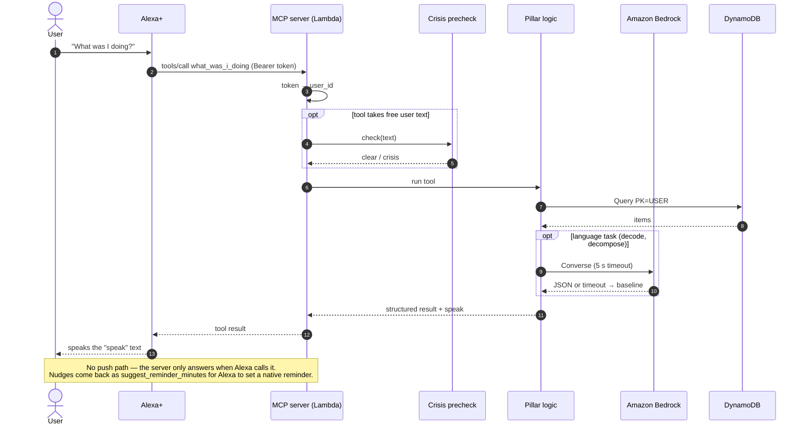
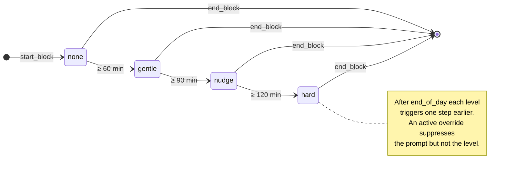
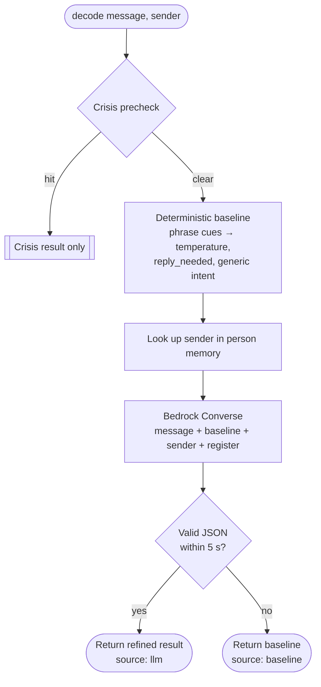
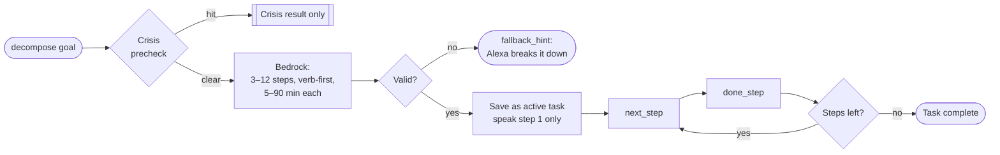
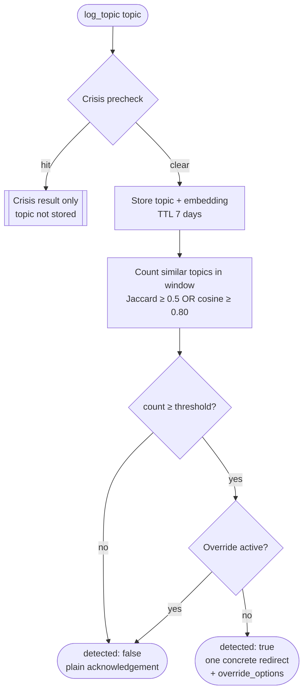
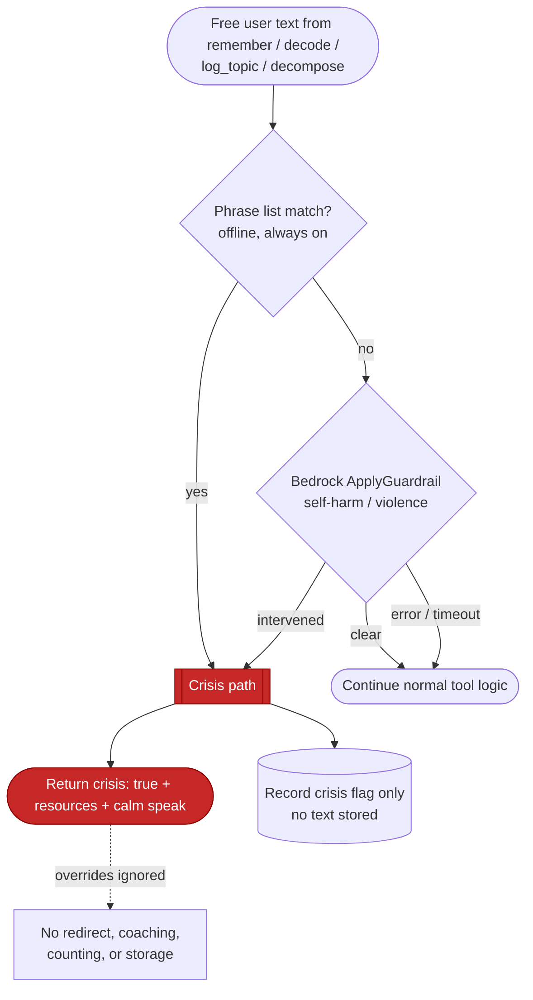
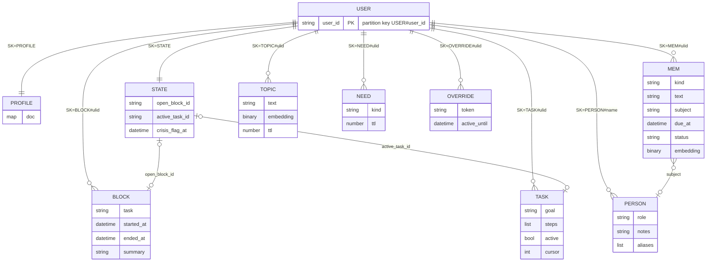
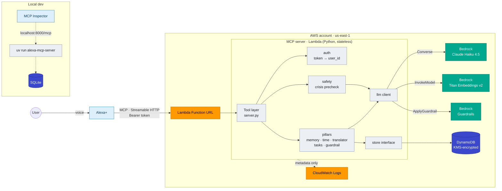
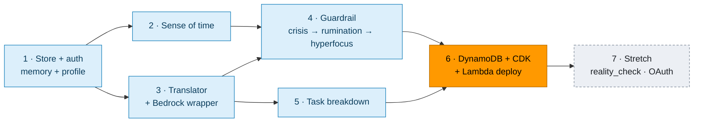

# NeuroCare — Spec

**NeuroCare** is a cognitive substrate for Alexa+: an MCP server that gives neurodivergent
people persistent memory, a sense of time, a translator for ambiguous messages, task
breakdown, and guardrails against rumination and hyperfocus.

> Status: **Draft v1 — decisions locked, no implementation yet**
> Companion to [`idea_draft.md`](../idea_draft.md). The idea draft explains *why*; this spec
> defines *what* gets built and *how*.

## 1. Purpose and scope

A single MCP server, served over **Streamable HTTP**, that Alexa+ connects to. It supplies
what a neurodivergent user often has to carry in their head: persistent memory, a felt sense
of time, decoding of ambiguous messages, a way to shrink big tasks, and a guardrail against
self-reinforcing loops.

### In scope (MVP)

| Pillar | Summary |
|---|---|
| Memory | User-owned facts, people, preferences, commitments, open loops |
| Sense of time | Work blocks, elapsed time, next commitment, leave-by buffers, drift check-ins |
| Ambiguity translator | Decode a message's literal meaning, likely intent, temperature, and reply needs |
| Task breakdown | Split a vague goal into small, time-boxed steps; surface one step at a time |
| Guardrail | Crisis path, rumination detection, hyperfocus check-ins, user overrides |

### Out of scope (MVP)

- Sycophancy `reality_check` (stretch goal, phase 7)
- Multi-user OAuth account linking (designed for, built later)
- Meeting transcript briefs, tone checking/rewriting of the user's own drafts
- Any medical, diagnostic, or treatment functionality

## 2. Alexa+ constraints and design responses

| Constraint | Design response |
|---|---|
| Alexa+ does not pass conversation history to tools | Server stores all history and state per user. Tools never require the model to carry IDs. |
| MCP sampling assumed unavailable | Server calls Amazon Bedrock itself for language tasks. |
| Server cannot initiate speech or push to the device | Checks run only when the user speaks. Results may include `suggest_reminder_minutes`; server instructions ask Alexa to set a native reminder. |
| Output is spoken, not read | Every tool result has a `speak` field: 1–2 short, literal sentences. Structured fields sit alongside for Alexa's reasoning. |
| Server influences Alexa only via instructions, tool descriptions, and results; it never sees the final reply | Guardrails are best-effort. Observed behaviour is recorded in the friction log. |
| Voice latency budget is tight | Non-LLM tools target < 1 s. Bedrock-backed tools time out at 5 s and fall back to the deterministic baseline. |

### Request lifecycle



## 3. Locked decisions

| Topic | Decision |
|---|---|
| License | Own permissive license (MIT or Apache-2.0; pick before first public push) |
| LLM usage | Hybrid: deterministic baseline computed first, refined by Bedrock; baseline returned if Bedrock fails or times out |
| Identity | MVP: one demo user, static bearer token (`AUTH_TOKEN`) maps to a fixed `user_id`. All data keyed by `user_id` so OAuth 2.1 (Cognito) drops in later without schema changes |
| Rumination input | Alexa calls `log_topic` when the user raises a worry, driven by server instructions and tool description |
| Crisis detection | Deterministic keyword/phrase list first, then Bedrock Guardrails `ApplyGuardrail`; a hit on either triggers the crisis path |
| Hosting | AWS Lambda + Function URL, MCP in stateless HTTP mode with JSON responses; all state in DynamoDB |
| Storage | One store interface; SQLite for local dev and tests, DynamoDB on AWS; selected by `STORE` env var |
| Recall matching | Tiered: exact → alias → fuzzy → embedding (Titan Text Embeddings v2); first tier that clears its threshold wins |
| Profile | Set by voice (`set_preference`, `remember(kind=person)`) plus a YAML seed file for the demo; exposed as `profile://me` resource **and** `get_profile` tool |
| Bedrock model | Claude Haiku 4.5, configurable via `BEDROCK_MODEL_ID` (Nova can be swapped in) |
| Infrastructure as code | AWS CDK (Python), in `infra/` |
| Transport | Streamable HTTP only (hackathon requirement) |

## 4. Conventions for every tool

- **Result shape:** a JSON object. Always includes `speak: str`. Never includes raw stack traces.
- **No handles for the model to track:** the server resolves "current block", "current task",
  and "last topic" itself. IDs appear in results for traceability but are never required as input
  (tools that act on an item accept free text and resolve it).
- **Crisis precheck:** tools that accept free user text (`remember`, `decode`, `log_topic`,
  `decompose`) run the crisis check first. On a hit they return the crisis result (§6) and do
  nothing else.
- **Errors:** returned as `{ "error": { "code": str, "message": str }, "speak": str }`.
  Common codes: `UNAUTHORIZED`, `INVALID_ARGUMENT`, `NOT_FOUND`, `LLM_UNAVAILABLE` (only when no
  deterministic fallback exists), `CONFIRMATION_REQUIRED`.
- **Timestamps:** ISO 8601 with offset, in the user's profile timezone.
- **Durations in `speak`:** rounded, spoken form ("about an hour and ten minutes").

## 5. Tool contracts

### 5.1 Memory

#### `remember(text, kind="fact", subject=None, due_at=None)`
Store something the user wants kept.

| Param | Type | Notes |
|---|---|---|
| `text` | str (≤ 2000) | What to remember, in the user's words |
| `kind` | `fact \| person \| preference \| commitment` | `commitment` creates an open loop |
| `subject` | str? | Person or project it's about; for `person`, the person's name |
| `due_at` | datetime? | Commitments only |

Returns `{ id, kind, deduplicated: bool, speak }`.
Deduplication: same `kind` + `subject` and text similarity above the fuzzy threshold updates the
existing item instead of creating a new one.
`speak`: "Got it. I'll remember Priya is your manager and tends to be blunt."

#### `recall(query, kind=None, limit=5)`
Returns `{ matches: [{ id, text, kind, subject, created_at, resolution }], speak }` where
`resolution ∈ exact | alias | fuzzy | embedding`. Empty `matches` is a valid result.
`speak`: "You told me on Monday that the report is due Friday."

#### `what_was_i_doing()`
Context restore after an interruption. Returns
`{ current_block?, last_block?, recent_memories[≤3], open_loops[≤3], speak }`.
`speak`: "You were drafting the budget email. You started 40 minutes ago. Two things are still open: reply to Sam, and book the dentist."

#### `open_loops(limit=5)`
Unfinished commitments and pending replies, soonest due first.
Returns `{ loops: [{ id, text, due_at? }], speak }`.

#### `close_loop(text)`
Resolves `text` against open loops (same tiered matching as `recall`). Returns
`{ closed: { id, text } | null, candidates?: [...], speak }`. If more than one candidate is close,
nothing is closed and `candidates` is returned so Alexa can ask which one.

#### `get_profile()`
Returns the full profile (§7) plus `speak` with a short summary. Mirrors the `profile://me` resource.

#### `set_preference(key, value)`
`key` is a dotted path from the profile schema (e.g. `time.end_of_day`,
`guardrail.rumination_threshold`). Values are validated against the schema's type and range.
Returns `{ key, old_value, new_value, speak }`.

#### `export_all()`
Returns every stored item for the user as structured JSON, plus `speak` saying how many items were exported.

#### `delete_all(confirm=False)`
With `confirm=False` returns `CONFIRMATION_REQUIRED` and a `speak` asking the user to confirm.
With `confirm=True` deletes every item for the user. Irreversible.

### 5.2 Sense of time

#### `now_context()`
Returns
```
{
  now, day_of_week, energy_zone,
  current_block?: { task, started_at, elapsed_minutes },
  next_commitment?: { text, due_at, minutes_until, leave_by? },
  speak
}
```
`energy_zone ∈ early | morning | midday | afternoon_dip | evening | late_night`, using
profile-configurable hour ranges.
`leave_by` = `due_at − travel_minutes − leave_buffer_minutes`, where `travel_minutes` is stored on
the commitment if known.
`speak`: "It's 2:10. You've been on the slides for 25 minutes. Your call with Sam is at 3, so you've got about 35 minutes."

#### `start_block(task)`
Starts a tracked block of work. If a block is open, it's closed automatically and reported.
Returns `{ block_id, started_at, auto_closed?: { task, minutes }, speak }`.

#### `end_block(summary=None)`
Closes the current block. Returns `{ task, minutes, speak }`; `NOT_FOUND` if none open.

#### `check_in()`
Drift and hyperfocus check against the open block.

| Level | Default trigger (minutes elapsed) |
|---|---|
| `none` | < 60 |
| `gentle` | ≥ 60 |
| `nudge` | ≥ 90 |
| `hard` | ≥ 120 |

After `time.end_of_day`, each level triggers one step earlier. Thresholds come from the profile.


Returns `{ level, elapsed_minutes, task, suggest_reminder_minutes?, override_options, speak }`.
The `speak` quotes the user's own task wording and states facts, not instructions:
"You started the budget email 95 minutes ago." At `nudge` and `hard`, a concrete option is offered
("Want a 5-minute break, or keep going?").

### 5.3 Ambiguity translator

#### `decode(message, sender=None)`

| Param | Type | Notes |
|---|---|---|
| `message` | str (≤ 4000) | The message the user received |
| `sender` | str? | Name; resolved against `person` memories |

Returns
```
{
  literal: str,
  likely_intents: [{ reading: str, confidence: float }],   # 1–3, confidences sum ≤ 1
  temperature: "neutral" | "warm" | "tense",
  reply_needed: bool,
  reply_by?: str,
  suggested_reply?: str,          # in the user's register from profile
  sender_context_used: bool,
  source: "llm" | "baseline",
  speak
}
```

Pipeline:
1. Crisis precheck.
2. **Deterministic baseline:** phrase cues (hedges, deadline words, escalation phrases such as
   "per my last email", "just following up", question marks directed at the user) set a baseline
   `temperature`, `reply_needed`, and one generic `likely_intent`.
3. **Bedrock refine:** prompt includes the message, the baseline, the sender's stored profile
   ("manager, blunt, not angry"), and the user's preferred register. Output is validated against a
   JSON schema. On timeout/invalid output → return baseline with `source: "baseline"`.



`speak` gives the most likely reading first, then whether a reply is needed:
"Most likely Priya just wants a status update — she's usually this short. Not urgent. A one-line reply today is fine."

### 5.4 Task breakdown

#### `decompose(goal, max_step_minutes=25)`
Splits a goal into 3–12 ordered steps, each 5–90 minutes (capped by `max_step_minutes`) and each
starting with a concrete verb. Stored as the user's active task list, replacing any previous one
(the old list is kept and marked inactive).
Returns `{ task_id, steps: [{ n, text, minutes }], speak }`; `speak` reads only step 1.
If Bedrock fails, returns `{ steps: [], fallback_hint, speak }` where `fallback_hint` asks Alexa to
break the goal down itself and save it with `remember(kind=commitment)`.

#### `next_step()`
Returns only the next undone step of the active task: `{ n, text, minutes, remaining, speak }`.

#### `done_step()`
Marks the current step done. Returns `{ completed, next?: {...}, remaining, speak }`.



### 5.5 Guardrail

#### `log_topic(topic)`
Called by Alexa when the user raises a worry or keeps coming back to a subject.

1. Crisis precheck (on full `topic` text).
2. Store the topic with timestamp and embedding.
3. Count earlier topics inside `guardrail.rumination_window_minutes` that are similar:
   Jaccard word overlap ≥ 0.5 **or** embedding cosine ≥ 0.80.
4. If `count ≥ guardrail.rumination_threshold` and no active override:
   `detected = true`, `redirect` = one concrete action (a next physical step, write it down, or a
   deliberate switch) chosen from the profile's preferred redirects.

Returns `{ detected, count, window_minutes, redirect?, override_options, speak }`.


`speak` when detected: "This is the third time in an hour we've come back to the presentation. Want to write down the one thing you're worried about and set it aside until tomorrow at 10?"

#### `check_hyperfocus()`
Combines `check_in()` with body needs: time since last `water`, `food`, and `break`
(from `log_need`). A need is flagged if not logged within `guardrail.need_intervals`
(defaults: water 120 min, food 300 min, break 90 min).
Returns `{ level, elapsed_minutes, unmet_needs: [...], suggest_reminder_minutes?, override_options, speak }`.
`speak`: "You've been on this for three and a half hours. No water logged since 11."

#### `log_need(kind)`
`kind ∈ water | food | break`. Returns `{ kind, logged_at, speak }`.

#### `override(token)`
Fixed token set:

| Token | Effect |
|---|---|
| `snooze_15m` | Suppress guardrail prompts for 15 minutes |
| `keep_going_once` | Suppress the next single guardrail prompt |
| `pause_for_session` | Suppress until the current block ends |
| `lower_sensitivity` | Raise the relevant threshold by one step (persisted to profile) |

Every override is logged with a timestamp. Overrides never apply to the crisis path.
Returns `{ token, active_until?, speak }`.

## 6. Safety

### Crisis path
- Runs **before** any other logic in `remember`, `decode`, `log_topic`, `decompose`.
- Step 1: deterministic phrase list (self-harm, suicide, "can't go on", etc.), case- and
  punctuation-insensitive. Always available, no network.
- Step 2: Bedrock Guardrails `ApplyGuardrail` on the same text (self-harm/violence filters).
  Failure of step 2 does not block step 1.
- On a hit: return only
  `{ crisis: true, resources: [...], speak }` — no redirect, coaching, counting, or storage of the
  text. `speak`: calm, short, gives the resource ("You can call or text 988 any time to talk to someone right now.").
- Resources by locale from profile; default US: 988 Suicide & Crisis Lifeline (call or text 988),
  emergency 911; non-US fallback points to a local emergency number and an international helpline directory.
- Only a boolean crisis event (no content) is recorded, so repeated crisis responses stay consistent.



### General
- No medical claims. Positioned as a productivity and communication aid.
- Self-identification is enough; no diagnosis fields are required or stored.
- No user content in logs or error payloads; logs carry tool name, latency, result code only.
- Encrypted at rest (DynamoDB default KMS; SQLite file is local dev only).
- User owns data: `export_all`, `delete_all`.
- Demo uses synthetic data only.

## 7. Profile schema

Stored as one `PROFILE` item; seeded from `profile_seed.yaml` in the demo.

| Path | Type | Default | Notes |
|---|---|---|---|
| `display_name` | str | — | Required |
| `timezone` | IANA tz | `America/New_York` | |
| `locale` | str | `en-US` | Crisis resources + phrasing |
| `style.register` | `plain \| warm \| formal` | `plain` | Used for suggested replies |
| `style.max_steps_spoken` | int 1–5 | 1 | How many steps/items `speak` reads out |
| `style.literal` | bool | `true` | Avoid idioms and metaphors in `speak` |
| `time.end_of_day` | `HH:MM`? | none | Shifts check-in levels earlier after this |
| `time.leave_buffer_minutes` | int 0–120 | 15 | Added before commitments |
| `time.checkin_thresholds` | `{gentle, nudge, hard}` minutes | 60/90/120 | Each 15–480, ascending |
| `time.energy_zones` | map zone → `HH:MM-HH:MM` | preset | |
| `guardrail.rumination_threshold` | int 2–20 | 3 | |
| `guardrail.rumination_window_minutes` | int 5–1440 | 90 | |
| `guardrail.need_intervals` | `{water, food, break}` minutes | 120/300/90 | |
| `guardrail.preferred_redirects` | str[] | preset list | Concrete actions offered on rumination |
| `people` | map name → `{role, notes, aliases[]}` | {} | Mirrors `person` memories for fast lookup |
| `consent.embeddings` | bool | `true` | If false, recall/rumination skip the embedding tier |

## 8. Data model

### DynamoDB (single table)

- Table: `cognitive-substrate` (name via `TABLE_NAME`)
- Keys: `PK = USER#<user_id>`, `SK = <TYPE>#<sortable id>`
- Sortable ids: ULIDs (time-ordered)

| SK prefix | Item | Key attributes |
|---|---|---|
| `PROFILE` | Profile document | `doc` (map) |
| `MEM#` | fact / preference / commitment | `kind`, `text`, `subject`, `due_at`, `status`, `embedding` |
| `PERSON#<name>` | person | `role`, `notes`, `aliases` |
| `BLOCK#` | work block | `task`, `started_at`, `ended_at`, `summary` |
| `TASK#` | task breakdown | `goal`, `steps`, `active`, `cursor` |
| `TOPIC#` | rumination topic | `text`, `embedding`, `ttl` |
| `NEED#` | water/food/break log | `kind`, `ttl` |
| `OVERRIDE#` | override log | `token`, `active_until` |
| `STATE` | pointers | `open_block_id`, `active_task_id`, `crisis_flag_at` |

- `embedding`: float32 vector stored as binary (1024 dims for Titan v2 at default size).
- TTL: `TOPIC#` and `NEED#` expire after 7 days.
- Access is always by `PK` (single user partition); similarity is computed in-process — per-user
  corpora are small.



### SQLite (local)

Same logical items in one table `items(pk, sk, type, doc JSON, embedding BLOB, ttl)`, so the store
interface and tests are identical across backends.

## 9. Architecture


Same flow as Mermaid (renders even without the image), with the server's internal layers:



Planned module layout (not yet created):

```
src/alexa_mcp_server/
  server.py          MCPServer instance, instructions, tool registration, main()
  config.py          env settings
  auth.py            bearer token → user_id
  store/             base.py (interface), sqlite.py, dynamo.py
  llm/               bedrock.py, fake.py (tests)
  pillars/           memory.py, time.py, translator.py, tasks.py, guardrail.py
  safety/crisis.py   phrase list + ApplyGuardrail
  lambda_handler.py  ASGI → Lambda adapter
profile_seed.yaml
infra/               CDK app: table, Lambda, Function URL, IAM (Bedrock InvokeModel, ApplyGuardrail), Guardrail
```

Pillar modules are plain functions taking `(store, llm, user_id, ...)` so they are testable
without MCP; `server.py` is a thin tool layer over them.

**Regenerating the AWS diagram** (dev-only, needs Graphviz):

```bash
brew install graphviz
uv run --no-project --with diagrams python docs/diagrams/aws_architecture.py
```

Environment variables: `STORE`, `TABLE_NAME`, `SQLITE_PATH`, `AUTH_TOKEN`, `DEMO_USER_ID`,
`BEDROCK_MODEL_ID`, `BEDROCK_EMBED_MODEL_ID`, `BEDROCK_GUARDRAIL_ID`, `BEDROCK_GUARDRAIL_VERSION`,
`AWS_REGION`, `HOST`, `PORT`.

## 10. Server instructions (draft)

```
You are connected to a personal cognitive support server for this user.

- When the user returns after a break or asks what they were doing, call what_was_i_doing.
- When the user raises a worry or comes back to a subject that is bothering them, call log_topic
  with a short description of the worry, before answering.
- When the user starts or finishes a piece of work, call start_block or end_block.
- When a tool result includes suggest_reminder_minutes, offer to set an Alexa reminder for that time.
- When the user asks what a message means, call decode.
- Speak the `speak` field from tool results in plain, literal words. Do not add idioms.
- Prefer accuracy over agreement. If the user's claim conflicts with what memory shows, say so gently.
- If a tool result has crisis: true, say only the provided message and resources. Do not redirect,
  coach, or change the subject.
- The user is in charge. If they say "I know, keep going", call override with keep_going_once.
```

## 11. Build phases and acceptance criteria

Each phase is demoable on its own.

| # | Phase | Done when |
|---|---|---|
| 1 | Store interface + SQLite, auth, memory tools, profile + seed | All memory tools pass tests; `what_was_i_doing` returns seeded context in Inspector |
| 2 | Sense of time | `check_in` level boundaries tested at 59/60/89/90/119/120 min and after end-of-day; `now_context` leave-by correct |
| 3 | Translator + Bedrock wrapper | Baseline-only path tested with fake LLM failure; schema-validated LLM path tested with fake LLM; one live Bedrock smoke test |
| 4 | Guardrail: crisis → rumination → hyperfocus | Crisis precheck short-circuits all four text tools (tested); 3rd similar `log_topic` inside window detects; override suppresses; crisis ignores override |
| 5 | Task breakdown | Steps validated (count, minutes, verb-first); `next_step`/`done_step` walk the list; fallback on LLM failure |
| 6 | DynamoDB store + CDK + Lambda | Same test suite passes against moto-backed DynamoDB; `cdk deploy` succeeds; Inspector connects to Function URL `/mcp` with token |
| 7 | Stretch | `reality_check(claim)`; Cognito OAuth 2.1 |



### Test approach
- `uv run pytest`; in-process MCP tests through `mcp.Client(mcp)` for tool listing, argument
  validation, `speak` presence, and crisis short-circuit.
- Pillar tests run against both store backends (parameterized fixture): SQLite and moto DynamoDB.
- `FakeLLM` returns scripted outputs or raises, for both refine and fallback paths.
- Time is injected (clock fixture), never read from the wall clock in tests.
- Manual: MCP Inspector locally, then Alexa+ by voice, running the "One day" demo arc from the idea draft.

## 12. Open risks

| Risk | Mitigation |
|---|---|
| Alexa+ may weakly follow server instructions (e.g. not calling `log_topic` unprompted) | Strong tool descriptions; demo phrasing that triggers tools; document in friction log |
| Alexa+ may not read MCP resources | Profile also exposed as `get_profile` tool |
| Alexa+ auth / account linking model for MCP unverified | Bearer token for MVP; store keyed by `user_id` for later OAuth |
| Bedrock latency vs voice timeouts | 5 s timeout, deterministic fallback, Haiku-class model |
| Exact v2 `MCPServer` option for stateless HTTP / JSON response mode | Verify against current SDK docs at start of phase 6 |
| Lambda cold starts | Keep dependencies small; provisioned concurrency only if needed for demo |
| False positives in rumination/hyperfocus | Configurable thresholds, `lower_sensitivity` override, facts-not-instructions wording |
