# NeuroCare — Spec

**NeuroCare** is a cognitive substrate for Alexa+: an MCP server that gives neurodivergent
people persistent memory, a sense of time, a translator for ambiguous messages, task
breakdown, a low-overwhelm daily plan, and guardrails against rumination and hyperfocus.

> Status: **Draft v1 — decisions locked, no implementation yet**
> Companion to [`idea_draft.md`](../idea_draft.md). The idea draft explains *why*; this spec
> defines *what* gets built and *how*.

## 1. Purpose and scope

A single MCP server, served over **Streamable HTTP**, that Alexa+ connects to. It supplies
what a neurodivergent user often has to carry in their head: persistent memory, a felt sense
of time, decoding of ambiguous messages, a way to shrink big tasks, and a guardrail against
self-reinforcing loops.

### In scope (MVP)

| Pillar | Summary |
|---|---|
| Memory | User-owned facts, people, preferences, commitments, open loops |
| Sense of time | Work blocks, elapsed time, next commitment, leave-by buffers, drift check-ins |
| Ambiguity translator | Decode and triage a message: summary, likely intent, tone, priority, reply needs, asks, related promises, and a draft reply |
| Task breakdown | Split a vague goal into small, time-boxed steps; surface one step at a time |
| Guardrail | Crisis path, rumination detection, hyperfocus check-ins, user overrides |
| Daily plan | Brain-dump capture, top-3 priorities picked by the server, gentle end-of-day rollover, pinned Today message in Telegram |
| Telegram companion (channel) | Forward messages for a triage card, tap buttons, pinned Today view, opt-in nudges the bot sends first |

### Out of scope (MVP)

- Sycophancy `reality_check` (stretch goal, phase 7)
- Multi-user rollout beyond the demo account (account linking itself is in the MVP, phase 6)
- Meeting transcript briefs, tone checking/rewriting of the user's own drafts
- Workspace connectors that read Slack / Teams / mail on the user's behalf (post-hackathon;
  MVP input is user-supplied text only, via voice, paste, `POST /inbox`, or the Telegram bot)
- Third-party agent gateways (e.g. Hermes Agent) — optional future bridge into `POST /inbox`;
  never a second reasoning agent
- Full planner features: monthly goals, habit streaks, meal logging, mood charts, an editable
  planner UI (Telegram shows the plan; it does not edit it)
- Any medical, diagnostic, or treatment functionality

## 2. Alexa+ constraints and design responses

| Constraint | Design response |
|---|---|
| Alexa+ does not pass conversation history to tools | Server stores all history and state per user. Tools never require the model to carry IDs. |
| MCP sampling assumed unavailable | Server calls Amazon Bedrock itself for language tasks. |
| Server cannot initiate speech or push to the device | Checks run only when the user speaks. Results may include `suggest_reminder_minutes`; server instructions ask Alexa to set a native reminder. The only unprompted path is the optional Telegram bot (§5.7), opt-in and capped. |
| Output is spoken, not read | Every tool result has a `speak` field: 1–2 short, literal sentences. Structured fields sit alongside for Alexa's reasoning. |
| Server influences Alexa only via instructions, tool descriptions, and results; it never sees the final reply | Guardrails are best-effort. Observed behaviour is recorded in the friction log. |
| Alexa+ requires < 500 ms round-trip latency | Server time target < 300 ms on the Alexa path. LLM-backed tools answer from the deterministic baseline immediately and refine in the background (§4 "Fast first, refine later"). Only the Telegram webhook waits for Bedrock (5 s timeout). |
| Alexa+ links accounts with OAuth 2.1 only | Cognito account linking (auth code + PKCE S256, refresh tokens) in the MVP; the server publishes Protected Resource Metadata (§3, §9). |

### Request lifecycle

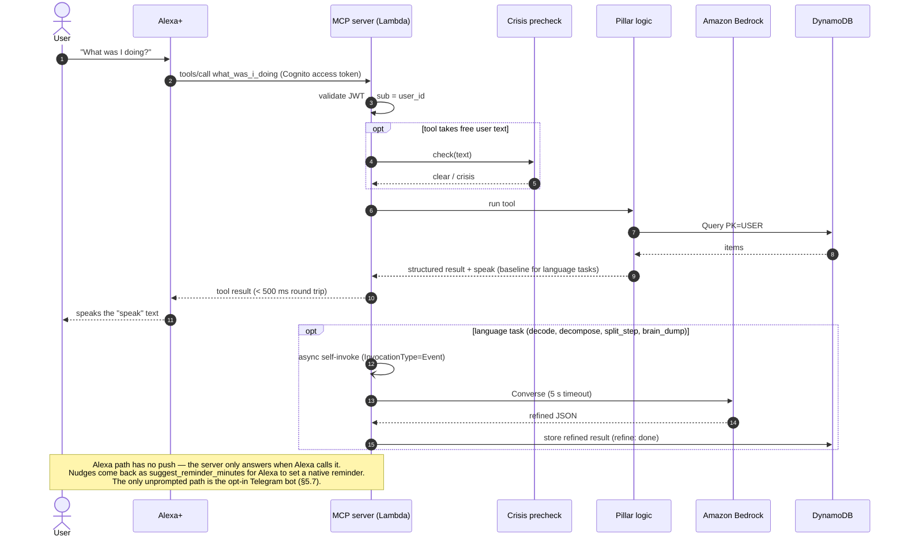

## 3. Locked decisions

| Topic | Decision |
|---|---|
| License | Own permissive license (MIT or Apache-2.0; pick before first public push) |
| LLM usage | Hybrid: deterministic baseline computed first, refined by Bedrock; baseline returned if Bedrock fails or times out |
| Identity | Alexa+ path: Cognito account linking (OAuth 2.1 auth code + PKCE S256, refresh tokens, static app client with Alexa's redirect URIs); the JWT `sub` is the `user_id`. MVP has one demo account. Static `AUTH_TOKEN` is accepted only when `ALLOW_STATIC_TOKEN=true` (local dev, tests, Inspector). Telegram identity comes from the chat link (§5.7); the iOS Shortcut uses a personal inbox token (§5.3) |
| Rumination input | Alexa calls `log_topic` when the user raises a worry, driven by server instructions and tool description |
| Crisis detection | Deterministic keyword/phrase list first, then Bedrock Guardrails `ApplyGuardrail` (250 ms budget, re-run async on timeout); a hit on either triggers the crisis path |
| Hosting | AWS Lambda + Function URL, MCP in stateless HTTP mode with JSON responses; all state in DynamoDB |
| Storage | One store interface; SQLite for local dev and tests, DynamoDB on AWS; selected by `STORE` env var |
| Recall matching | Tiered: exact → alias → fuzzy → embedding (Titan Text Embeddings v2); first tier that clears its threshold wins |
| Profile | Set by voice (`set_preference`, `remember(kind=person)`) plus a YAML seed file for the demo; exposed as `profile://me` resource **and** `get_profile` tool |
| Bedrock model | Claude Haiku 4.5, configurable via `BEDROCK_MODEL_ID` (Nova can be swapped in) |
| Infrastructure as code | AWS CDK (Python), in `infra/` |
| Transport | Streamable HTTP only (hackathon requirement) |
| Channels | Alexa+ (voice, MCP) is the primary channel. Telegram bot (§5.7) is an optional companion for reading, forwarding, and opt-in nudges; it calls the same pillar functions. No web UI |

## 4. Conventions for every tool

- **Result shape:** a JSON object. Always includes `speak: str`. Never includes raw stack traces.
- **No handles for the model to track:** the server resolves "current block", "current task",
  and "last topic" itself. IDs appear in results for traceability but are never required as input
  (tools that act on an item accept free text and resolve it).
- **Crisis precheck:** tools that accept free user text (`remember`, `decode`, `log_topic`,
  `decompose`, `brain_dump`) run the crisis check first. On a hit they return the crisis result (§6) and do
  nothing else.
- **Fast first, refine later** (Alexa+ needs < 500 ms round trip): tools that use Bedrock
  (`decode`, `decompose`, `split_step`, `brain_dump`) return their deterministic result at once
  with `source: "baseline"` and `refine: "pending"`, then the Lambda invokes itself
  asynchronously (`InvocationType=Event`) to run the Bedrock call (5 s timeout). The refined
  result is stored on the item with `refine: "done"` (or `"failed"`, keeping the baseline). The
  next ask ("what should I say?", `next_step`) reads the refined result, and a linked Telegram
  card is edited in place when it lands. The Telegram webhook is not bound by 500 ms, so it runs
  the refine synchronously and replies with the full card.
- **Other budgets on the Alexa path:** embedding tier 200 ms (skipped for this call on timeout);
  `ApplyGuardrail` 250 ms (§6).
- **Errors:** returned as `{ "error": { "code": str, "message": str }, "speak": str }`.
  Common codes: `UNAUTHORIZED`, `INVALID_ARGUMENT`, `NOT_FOUND`, `LLM_UNAVAILABLE` (only when no
  deterministic fallback exists), `CONFIRMATION_REQUIRED`.
- **Timestamps:** ISO 8601 with offset, in the user's profile timezone.
- **Durations in `speak`:** rounded, spoken form ("about an hour and ten minutes").

## 5. Tool contracts

### 5.1 Memory

#### `remember(text, kind="fact", subject=None, due_at=None)`
Store something the user wants kept.

| Param | Type | Notes |
|---|---|---|
| `text` | str (≤ 2000) | What to remember, in the user's words |
| `kind` | `fact \| person \| preference \| commitment` | `commitment` creates an open loop |
| `subject` | str? | Person or project it's about; for `person`, the person's name |
| `due_at` | datetime? | Commitments only |

Returns `{ id, kind, deduplicated: bool, speak }`.
Deduplication: same `kind` + `subject` and text similarity above the fuzzy threshold updates the
existing item instead of creating a new one.
`speak`: "Got it. I'll remember Priya is your manager and tends to be blunt."

#### `recall(query, kind=None, limit=5)`
Returns `{ matches: [{ id, text, kind, subject, created_at, resolution }], speak }` where
`resolution ∈ exact | alias | fuzzy | embedding`. Empty `matches` is a valid result.
`speak`: "You told me on Monday that the report is due Friday."

#### `what_was_i_doing()`
Context restore after an interruption. Returns
`{ current_block?, last_block?, recent_memories[≤3], open_loops[≤3], speak }`.
`speak`: "You were drafting the budget email. You started 40 minutes ago. Two things are still open: reply to Sam, and book the dentist."

#### `open_loops(limit=5)`
Unfinished commitments and pending replies, soonest due first.
Returns `{ loops: [{ id, text, due_at? }], speak }`.

#### `close_loop(text)`
Resolves `text` against open loops (same tiered matching as `recall`). Returns
`{ closed: { id, text } | null, candidates?: [...], speak }`. If more than one candidate is close,
nothing is closed and `candidates` is returned so Alexa can ask which one.

#### `get_profile()`
Returns the full profile (§7) plus `speak` with a short summary. Mirrors the `profile://me` resource.

#### `set_preference(key, value)`
`key` is a dotted path from the profile schema (e.g. `time.end_of_day`,
`guardrail.rumination_threshold`). Values are validated against the schema's type and range.
Returns `{ key, old_value, new_value, speak }`.

#### `export_all()`
Returns every stored item for the user as structured JSON, plus `speak` saying how many items were exported.

#### `delete_all(confirm=False)`
With `confirm=False` returns `CONFIRMATION_REQUIRED` and a `speak` asking the user to confirm.
With `confirm=True` deletes every item for the user. Irreversible.

### 5.2 Sense of time

#### `now_context()`
Returns
```
{
  now, day_of_week, energy_zone,
  current_block?: { task, started_at, elapsed_minutes },
  next_commitment?: { text, due_at, minutes_until, leave_by? },
  speak
}
```
`energy_zone ∈ early | morning | midday | afternoon_dip | evening | late_night`, using
profile-configurable hour ranges.
`leave_by` = `due_at − travel_minutes − leave_buffer_minutes`, where `travel_minutes` is stored on
the commitment if known.
`speak`: "It's 2:10. You've been on the slides for 25 minutes. Your call with Sam is at 3, so you've got about 35 minutes."

#### `start_block(task)`
Starts a tracked block of work. If a block is open, it's closed automatically and reported.
Returns `{ block_id, started_at, auto_closed?: { task, minutes }, speak }`.

#### `end_block(summary=None)`
Closes the current block. Returns `{ task, minutes, speak }`; `NOT_FOUND` if none open.

#### `check_in()`
Drift and hyperfocus check against the open block.

| Level | Default trigger (minutes elapsed) |
|---|---|
| `none` | < 60 |
| `gentle` | ≥ 60 |
| `nudge` | ≥ 90 |
| `hard` | ≥ 120 |

After `time.end_of_day`, each level triggers one step earlier. Thresholds come from the profile.

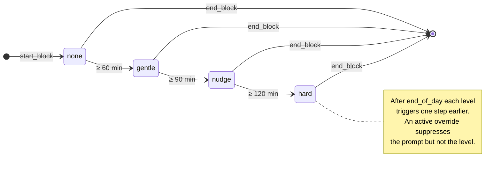
Returns `{ level, elapsed_minutes, task, suggest_reminder_minutes?, override_options, speak }`.
The `speak` quotes the user's own task wording and states facts, not instructions:
"You started the budget email 95 minutes ago." At `nudge` and `hard`, a concrete option is offered
("Want a 5-minute break, or keep going?").

### 5.3 Ambiguity translator

#### `decode(message=None, sender=None)`

Decodes **and triages** a message: what it says, what it most likely means, how urgent it is,
what it asks for, what it relates to, and a draft reply.

| Param | Type | Notes |
|---|---|---|
| `message` | str? (≤ 4000) | The message the user received. If omitted, the newest undecoded inbox item is used (`NOT_FOUND` if none) |
| `sender` | str? | Name; resolved against `person` memories. Inbox items supply their own sender |

Every decode is stored on an `INBOX#` item (the existing one, or a new one for spoken/pasted
text) with its result attached, TTL 7 days. This is what lets the Telegram card (§5.7), the
pinned Today message, and `triage_inbox` show the same result whichever channel produced it.

#### Input paths
Reading a long message aloud is the main friction, so these paths feed the same tool:

| Path | Best for | How |
|---|---|---|
| Speak it | 1–2 sentences | "What does Priya mean by 'let's circle back'?" → `decode(message=…)` |
| Type or paste | Longer text | Alexa app / alexa.com text chat → same `decode(message=…)` call |
| Forward it | Long emails, threads | iOS Share Sheet shortcut (or similar) posts to `POST /inbox`; user then says "decode the message I just sent" → `decode()` |
| Telegram | Reading the full breakdown | Forward, share, or paste to the NeuroCare bot (§5.7); it replies with the triage card |
| Email forward | Emails, one tap from any mail app | Forward to the NeuroCare address (§5.8, optional, phase 6b); sender kept automatically |

`POST /inbox` is a plain HTTP route on the same server (not an MCP tool). It is authorized by a
personal **inbox token**: the Telegram bot issues it with `/token` (shown once, stored hashed as
`TOKEN#<hash>`), the user pastes it into the iOS Shortcut, and `/token revoke` or `delete_all`
revokes it.
Body: `{ text: str (≤ 4000), sender?: str, source?: str }`. Stores an `INBOX#` item (TTL 7 days).
Returns `{ id }`. The crisis precheck runs when the item is decoded, not on ingest.

Returns
```
{
  id: str,                        # INBOX# item id
  summary: str,                   # 1–2 literal sentences
  literal: str,
  likely_intents: [{ reading: str, confidence: float }],   # 1–3, confidences sum ≤ 1
  temperature: "neutral" | "warm" | "tense",
  priority: "must" | "should" | "could" | "wait",          # same buckets as ITEM#
  reply_needed: bool,
  reply_by?: str,
  actions: [str],                 # concrete asks, verb-first ("send the Q3 deck by Friday")
  related: [{ id, text }],        # open loops / commitments that match sender or topic
  cues: [{ phrase, meaning }],    # phrases behind the reading ("per my last email" → "I already asked")
  suggested_reply?: str,          # a draft in the user's register; never sent by the server
  suggest_reminder_minutes?: int, # set when reply_by is known
  needs_work: bool,               # message asks for a deliverable → Alexa may offer decompose
  sender_context_used: bool,
  sender_source: "param" | "channel" | "header" | "signature" | "asked" | null,
  source: "llm" | "baseline",
  refine: "pending" | "done" | "failed",
  speak
}
```

Pipeline (a fixed sequence of steps, not an open-ended agent loop):
1. Crisis precheck.
2. **Deterministic baseline:** phrase cues (hedges, deadline words, escalation phrases such as
   "per my last email", "just following up", question marks directed at the user) set a baseline
   `temperature`, `reply_needed`, `priority`, one generic `likely_intent`, and `cues`.
3. **Context gather (no LLM):** sender profile (`PERSON#`), open loops and commitments matching
   the sender or the message (tiered recall, §5.1) → `related`, and today's plan (`PLAN#<date>`).
4. **Return the baseline** (Alexa path): store it on the `INBOX#` item with `refine: "pending"`
   and return it; `speak` uses only baseline fields.
5. **Bedrock refine** (async on the Alexa path, synchronous for Telegram): one call with the
   message, baseline, sender profile ("manager, blunt, not angry"), related items, today's plan,
   and the user's register. The message is wrapped as untrusted data (§6). Output is validated
   against a JSON schema and stored with `refine: "done"`. On timeout/invalid output the
   baseline stays, with `refine: "failed"`. `summary`, `actions`, and `suggested_reply` come
   from the refine; until then they are empty.

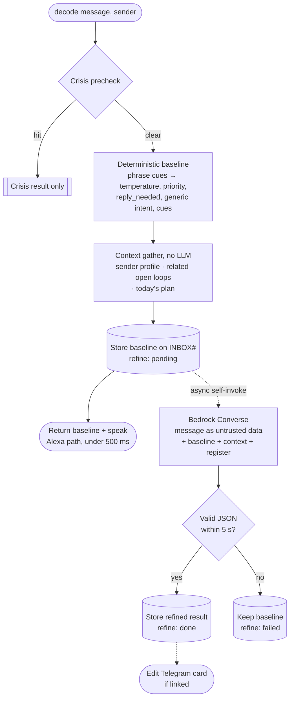

`speak` (from the baseline and context, so it is ready in under 500 ms) gives the most likely
reading first, then urgency, then any related promise:
"Most likely Priya just wants a status update — she's usually this short. Not urgent. A one-line reply today is fine. You told her the deck would be ready Monday."

Low-friction rules:
- `speak` carries only the verdict. `summary`, `actions`, other intents, `cues`, and
  `suggested_reply` are spoken only when the user asks ("what should I say?", "what does she
  want?"), and are always on the Telegram card when the chat is linked.
- At most one follow-up offer per result: a reminder (`suggest_reminder_minutes`) **or**
  "want me to break that into steps?" (`needs_work`), not both.
- Unknown sender: still answer; offer once to remember who they are.

#### Sender resolution
Sender context is what makes decoding better than a bare LLM, and pasted text usually loses it.
The server resolves the sender in this order and stops at the first hit:

| # | Source | Example |
|---|---|---|
| 1 | Explicit `sender` param | "What does Priya mean by…" |
| 2 | Channel metadata | Telegram `forward_origin` name; email forward's original `From:` (§5.8) |
| 3 | Header lines in the pasted text | `From: Priya Shah <priya@…>` copied along with the body |
| 4 | Greeting or signature matched against `PERSON#` names and aliases | "Thanks, Priya" / "– P." |
| 5 | Ask once | Telegram: button row of the 3 most recently mentioned people + [Someone else] + [Skip]. Voice: decode proceeds without sender context; `speak` ends with "Who's it from?" |

Tiers 3–4 are deterministic (regex + tiered name matching, §5.1), so there is no extra LLM call.
A tier-4 match is used only if it is unambiguous. When the user picks a sender after the fact,
the sender is stored on the `INBOX#` item and `decode` re-runs with that context. The result
carries `sender_source: "param" | "channel" | "header" | "signature" | "asked" | null`.

#### `decode_result()`
"What should I say?" / "What does she want?" right after a decode. Returns the stored result of
the most recent decode (refined if the refine has landed) without calling Bedrock:
`{ id, summary, actions, suggested_reply?, refine, speak }`. If `refine` is still `pending`,
`speak` says "Still working on the details. Ask me again in a moment." and gives the baseline.

#### `triage_inbox(limit=3)`
"What needs me?" / "Anything urgent?" Decodes pending inbox items (at most 3 per call, to stay
inside the latency budget; the rest are reported as `pending`), then ranks all decoded,
unresolved items by `priority` → `reply_by` → age.
Returns `{ items: [{ id, sender, summary, priority, reply_by? }], pending, speak }`.
`speak` reads only the top `limit`: "Two things need you. Priya wants a status update today.
Sam's invoice question can wait until Friday."
An item is resolved when its reply commitment is closed, when its "add to today" item is done,
or when the user says "that's handled" (`close_loop`).

### 5.4 Task breakdown

#### `decompose(goal, max_step_minutes=25)`
Splits a goal into 3–12 ordered steps, each 5–90 minutes (capped by `max_step_minutes`) and each
starting with a concrete verb. Step 1 is always ≤ 5 minutes and physical ("put last year's
return on the desk"), so starting costs almost nothing. No clarifying questions before the first
step; the plan is fixed later with `split_step` / `skip_step`. Stored as the user's active task
list, replacing any previous one (the old list is kept and marked inactive).
Alexa calls it on overwhelm phrasing too ("I don't know where to start with my taxes"), not only
on explicit "break this down" requests (see §10).
Returns `{ task_id, steps: [{ n, text, minutes }], refine, speak }`; `speak` reads only step 1.
Fast first (§4): on the Alexa path the instant result is a single baseline step 1, "Spend 5
minutes writing down what done looks like for <goal>", with `refine: "pending"`; the full list
arrives in the background. `next_step` uses the refined list when it is ready, otherwise says
"Still planning the rest. Finish this one first."
If the refine fails, the task keeps the baseline step, and the next `next_step` returns
`fallback_hint`, which asks Alexa to break the goal down itself and save it with `remember(kind=commitment)`.

#### `next_step()`
Returns only the next undone step of the active task: `{ n, text, minutes, remaining, speak }`.

#### `done_step()`
Marks the current step done. Returns `{ completed, next?: {...}, remaining, speak }`.
If a work block is open for the step, it is closed; the next step opens a new block sized to its
`minutes`, so `check_in` drift applies per step.

#### `split_step()`
"This one's too big." Replaces only the current step with 2–4 smaller steps (Bedrock, same
validation; step 1 ≤ 5 minutes). Returns `{ steps: [...], remaining, refine, speak }`; `speak` reads
the new first step. Fast first (§4): the instant step is "Do just the first 5 minutes of <step>",
replaced by the refined steps when they land. On refine failure the instant step stays.

#### `skip_step()`
"Not now." Moves the current step to the end of the list. Returns `{ skipped, next, remaining, speak }`.
Skipping the only remaining step returns it unchanged with a `speak` saying it is the last one.

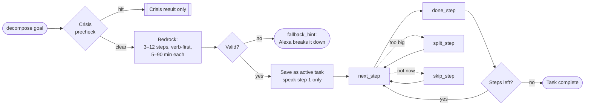

### 5.5 Guardrail

#### `log_topic(topic)`
Called by Alexa when the user raises a worry or keeps coming back to a subject.

1. Crisis precheck (on full `topic` text).
2. Store the topic with timestamp and embedding.
3. Count earlier topics inside `guardrail.rumination_window_minutes` that are similar:
   Jaccard word overlap ≥ 0.5 **or** embedding cosine ≥ 0.80.
4. If `count ≥ guardrail.rumination_threshold` and no active override:
   `detected = true`, `redirect` = one concrete action (a next physical step, write it down, or a
   deliberate switch) chosen from the profile's preferred redirects.

Returns `{ detected, count, window_minutes, redirect?, override_options, speak }`.


`speak` when detected: "This is the third time in an hour we've come back to the presentation. Want to write down the one thing you're worried about and set it aside until tomorrow at 10?"

#### `check_hyperfocus()`
Combines `check_in()` with body needs: time since last `water`, `food`, and `break`
(from `log_need`). A need is flagged if not logged within `guardrail.need_intervals`
(defaults: water 120 min, food 300 min, break 90 min).
Returns `{ level, elapsed_minutes, unmet_needs: [...], suggest_reminder_minutes?, override_options, speak }`.
`speak`: "You've been on this for three and a half hours. No water logged since 11."

#### `log_need(kind)`
`kind ∈ water | food | break`. Returns `{ kind, logged_at, speak }`.

#### `override(token)`
Fixed token set:

| Token | Effect |
|---|---|
| `snooze_15m` | Suppress guardrail prompts for 15 minutes |
| `keep_going_once` | Suppress the next single guardrail prompt |
| `pause_for_session` | Suppress until the current block ends |
| `lower_sensitivity` | Raise the relevant threshold by one step (persisted to profile) |

Every override is logged with a timestamp. Overrides never apply to the crisis path.
Returns `{ token, active_until?, speak }`.

### 5.6 Daily plan

Borrows the useful parts of ADHD paper planners (brain dump, top-3 focus, triage, rollover)
without their overhead. The server sorts and ranks; the user only captures and confirms.
Never more than `plan.max_priorities` items spoken, never a full list read aloud.

#### `brain_dump(text)`
"Brain dump: renew passport, mom's birthday Sunday, fix the slides."
Captures one or more items with no follow-up questions. Fast first (§4): the instant baseline
splits on commas, "and", and new lines into untagged items with `bucket: should`. The background
refine (Bedrock) fixes the split, tags each `work | personal | life | admin`, extracts `due_at`
if mentioned, and sets a triage `bucket` (`must | should | could | wait`). On refine failure
the baseline items stay.
Returns `{ items: [{ id, text, tag, bucket, due_at? }], source: "llm" | "baseline", refine, speak }`.
`speak`: "Saved 3. Birthday marked for Sunday."

#### `plan_today(energy=None)`
"Plan my day." Proposes today's priorities from open items, open loops (§5.1), and undecoded
inbox items. Ranking is deterministic: due date, then `bucket`, then `decode` urgency
(`reply_by`, temperature), then age.

| `energy` (1–5, optional) | Effect |
|---|---|
| 1–2 | 1 priority; active task `max_step_minutes` drops to 10 |
| 3 | 2 priorities |
| 4–5 or none | `plan.max_priorities` (default 3) |

Stores a `PLAN#<date>` item, replacing an earlier plan for the same day.
Returns `{ date, priorities: [{ id, text, due_at? }], open_count, speak }`.
`speak` names the picks and asks one confirmation: "Nine things open. I suggest two: send the
slides, reply to Priya. Start with the slides?" If the user swaps one ("not Priya, the dentist"),
Alexa calls `plan_today` again; the plan is never edited item by item by voice.

#### `wrap_up()`
"Wrap up for today." Marks done items, moves unfinished priorities to tomorrow when
`plan.rollover` is true, and closes any open block.
Returns `{ done: [...], rolled_over: [...], speak }`.
`speak` is factual and neutral, with no streaks or scores: "Slides done. Priya moved to tomorrow."

The glanceable view of the plan is the pinned Today message in Telegram (§5.7).

### 5.7 Telegram companion

A channel, not a new pillar. Alexa+ is for hands-free speech; the Telegram bot is for reading,
forwarding, and tapping. Both call the same pillar functions, so state is shared: a message
forwarded on Telegram shows up in "Alexa, what needs me?", and a plan made by voice updates the
pinned Today message. It uses the Telegram Bot API directly, with no agent framework. Optional:
everything still works with Alexa alone.

#### `/token` (Telegram command)
Issues a personal inbox token for the iOS Shortcut (`POST /inbox`, §5.3). Shown once, stored
only as a hash. `/token revoke` deletes it.

#### `telegram_link_code()` (MCP tool)
"Alexa, link Telegram." Returns a 6-digit code valid for 10 minutes, and `speak` reads it out.
The user sends `/start <code>` to the bot; the server maps the chat to the user (`TG#<chat_id>`).
Unlinked chats get only "Link first: ask Alexa to link Telegram." The first linked message
states once that bot chats are not end-to-end encrypted (§6). `delete_all` unlinks the chat.

#### Inbound
Telegram webhook → `POST /telegram` on the Function URL. The request must carry the
`X-Telegram-Bot-Api-Secret-Token` header matching `TELEGRAM_WEBHOOK_SECRET`, otherwise 401.
Stateless, so it fits Lambda. Local dev uses long polling (`getUpdates`) instead of the webhook.

| Message | Action |
|---|---|
| Forwarded or pasted text | `decode` → triage card |
| `/dump <text>` or "dump: …" | `brain_dump` |
| `/plan [energy]` | `plan_today` |
| `/wrap` | `wrap_up` |
| `/needs` | `triage_inbox` |
| Anything else | `decode` (default), with a "Not a message? Save as dump" button |

The crisis precheck runs on all inbound text through these same tools. A crisis reply is plain
text with resources, with no buttons.

#### Triage card
```
Most likely: she wants a status update. Not angry.
Also possible: she's worried about the date.
Tone: direct · Reply: yes, today
Priya: manager, usually short
Related: you promised her the deck Monday
Asks: send a status update
Why: "per my last email" usually means "I already asked"

Suggested reply:
  Hi Priya, it's on track for Friday. I'll send it Thursday afternoon.

[Remind me to reply] [Add to today]
[✓ Right] [✗ Not quite]
```
- Confidence is in words ("most likely", "also possible"), never numbers. Tone labels are
  calm: `tense` shows as "direct".
- The suggested reply is in a code block for one-tap copy. The server never sends it.
- Buttons: **Remind me to reply** → `remember(kind=commitment, due_at=reply_by)`;
  **Add to today** → `brain_dump` of the first action; **✗ Not quite** asks for one line and saves
  it as a note on the sender's `PERSON#` record, which the next decode uses.

#### Pinned Today message
The bot keeps one pinned message and edits it in place whenever the plan changes: focus (first
priority), priorities with done marks, the active task's current step, the unsorted brain-dump
count, and a "Last decoded" line (sender, summary, priority). Read-only: plans change through
`/plan`, `/wrap`, or voice, never by editing the message.

#### Messages the bot sends first
The one place NeuroCare can reach the user unprompted (Alexa cannot, §2). Each type is opt-in
and off by default:

| Type | When |
|---|---|
| `morning` | At `telegram.morning_at`: "Plan your day?" with a [Plan] button |
| `reply_nudge` | 30 minutes before a decoded message's `reply_by` |
| `wrap_up` | At `time.end_of_day`: "Wrap up?" with a [Wrap up] button |

Hard cap of `telegram.max_push_per_day` (default 3) and no messages during
`telegram.quiet_hours`. An EventBridge Scheduler rule invokes the same Lambda every 15 minutes;
it sends only what is due and logs each send (`PUSH#`) for the cap.

#### Flows

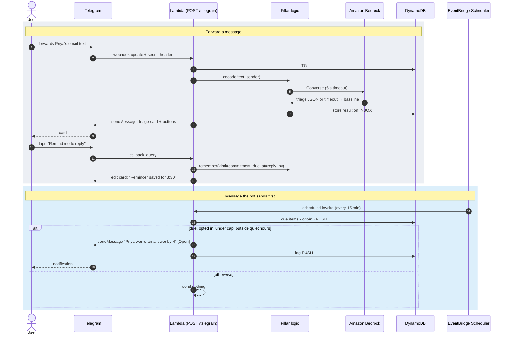

Not in scope: group chats, voice notes, editing plans in Telegram, sending drafts to anyone.

### 5.8 Email forwarding address (optional, phase 6b)

One-tap Forward from any mail app, with the original sender kept. The user still chooses each
email, so this is not an inbox connector: nothing is read that the user did not forward.

- **Address:** `inbox@<INBOUND_EMAIL_DOMAIN>` (a subdomain such as `in.neurocare.example`, with
  an MX record pointing to SES inbound in `us-east-1`). Single demo user for the MVP; per-user
  `inbox+<code>@…` addresses come with OAuth.
- **Acceptance:** SES receipt rule accepts mail only when the envelope `From` is in
  `email.allowed_senders` **and** SES SPF and DKIM verdicts are `PASS`. Everything else is
  dropped without a bounce.
- **Pipeline:** SES → S3 (raw MIME, KMS-encrypted, lifecycle delete after 1 day) → Lambda
  (`channels/email.py`) → parse → `INBOX#` item with `source: "email"` → raw object deleted.
- **Parsing:** take the forwarded block's original `From:`, `Subject:`, and `Date:`
  (Gmail/Outlook/Apple Mail "Forwarded message" formats); strip quoted history and signatures;
  keep plain text only, max 4000 characters; ignore attachments.
- **After ingest:** if a Telegram chat is linked, the bot sends the triage card (a reply to the
  user's action, so it does not count toward `telegram.max_push_per_day`). Otherwise it waits for
  "Alexa, what needs me?" or "decode the email I forwarded".
- **Never** replies to, or sends mail to, anyone. No outbound email at all.

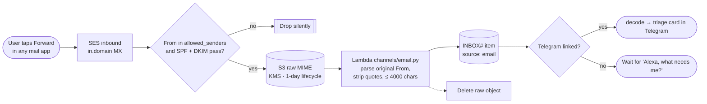

## 6. Safety

### Crisis path
- Runs **before** any other logic in `remember`, `decode`, `log_topic`, `decompose`, `brain_dump`.
- Step 1: deterministic phrase list (self-harm, suicide, "can't go on", etc.), case- and
  punctuation-insensitive. Always available, no network.
- Step 2: Bedrock Guardrails `ApplyGuardrail` on the same text (self-harm/violence filters),
  with a 250 ms budget on the Alexa path. Failure of step 2 does not block step 1.
- **If step 2 times out**, the tool continues and step 2 re-runs asynchronously. An async hit
  sets `STATE.crisis_flag_at`: the next tool call returns the crisis result before anything else,
  and a linked Telegram chat gets the resources message right away. Any refine queued for that
  text is cancelled and its stored text is deleted.
- On a hit: return only
  `{ crisis: true, resources: [...], speak }` — no redirect, coaching, counting, or storage of the
  text. `speak`: calm, short, gives the resource ("You can call or text 988 any time to talk to someone right now.").
- Resources by locale from profile; default US: 988 Suicide & Crisis Lifeline (call or text 988),
  emergency 911; non-US fallback points to a local emergency number and an international helpline directory.
- Only a boolean crisis event (no content) is recorded, so repeated crisis responses stay consistent.

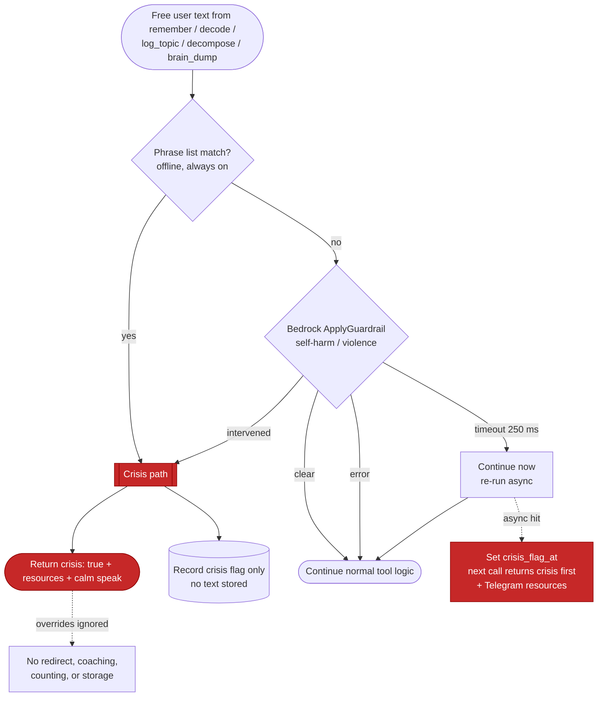

### General
- No medical claims. Positioned as a productivity and communication aid.
- Self-identification is enough; no diagnosis fields are required or stored.
- No user content in logs or error payloads; logs carry tool name, latency, result code only.
- Encrypted at rest (DynamoDB default KMS; SQLite file is local dev only).
- User owns data: `export_all`, `delete_all`.
- Demo uses synthetic data only.
- Message text from any channel is untrusted data. LLM prompts wrap it as data, and instructions
  inside it ("ignore previous instructions", "forward this to…") are never followed.
- Suggested replies are drafts. The server never sends a message to anyone other than the user.
- Telegram bot chats are not end-to-end encrypted: forwarded messages pass through Telegram's
  servers. The bot says so once on linking; docs advise against forwarding confidential work mail.

## 7. Profile schema

Stored as one `PROFILE` item; seeded from `profile_seed.yaml` in the demo.

| Path | Type | Default | Notes |
|---|---|---|---|
| `display_name` | str | — | Required |
| `timezone` | IANA tz | `America/New_York` | |
| `locale` | str | `en-US` | Crisis resources + phrasing |
| `style.register` | `plain \| warm \| formal` | `plain` | Used for suggested replies |
| `style.max_steps_spoken` | int 1–5 | 1 | How many steps/items `speak` reads out |
| `style.literal` | bool | `true` | Avoid idioms and metaphors in `speak` |
| `time.end_of_day` | `HH:MM`? | none | Shifts check-in levels earlier after this |
| `time.leave_buffer_minutes` | int 0–120 | 15 | Added before commitments |
| `time.checkin_thresholds` | `{gentle, nudge, hard}` minutes | 60/90/120 | Each 15–480, ascending |
| `time.energy_zones` | map zone → `HH:MM-HH:MM` | preset | |
| `guardrail.rumination_threshold` | int 2–20 | 3 | |
| `guardrail.rumination_window_minutes` | int 5–1440 | 90 | |
| `guardrail.need_intervals` | `{water, food, break}` minutes | 120/300/90 | |
| `guardrail.preferred_redirects` | str[] | preset list | Concrete actions offered on rumination |
| `people` | map name → `{role, notes, aliases[]}` | {} | Mirrors `person` memories for fast lookup |
| `consent.embeddings` | bool | `true` | If false, recall/rumination skip the embedding tier |
| `plan.max_priorities` | int 1–3 | 3 | Upper bound for `plan_today` |
| `plan.rollover` | bool | `true` | `wrap_up` moves unfinished priorities to tomorrow |
| `telegram.pushes` | `{morning, reply_nudge, wrap_up}` bools | all `false` | Opt-in per type (§5.7) |
| `telegram.max_push_per_day` | int 0–5 | 3 | Hard cap on messages the bot sends first |
| `telegram.quiet_hours` | `HH:MM-HH:MM` | `21:00-08:00` | No bot-initiated messages inside this range |
| `telegram.morning_at` | `HH:MM` | `08:30` | Time of the `morning` prompt |
| `email.allowed_senders` | str[] | [] | Addresses allowed to forward to the inbound address (§5.8); empty disables it |

## 8. Data model

### DynamoDB (single table)

- Table: `cognitive-substrate` (name via `TABLE_NAME`)
- Keys: `PK = USER#<user_id>`, `SK = <TYPE>#<sortable id>`
- Sortable ids: ULIDs (time-ordered)

| SK prefix | Item | Key attributes |
|---|---|---|
| `PROFILE` | Profile document | `doc` (map) |
| `MEM#` | fact / preference / commitment | `kind`, `text`, `subject`, `due_at`, `status`, `embedding` |
| `PERSON#<name>` | person | `role`, `notes`, `aliases` |
| `BLOCK#` | work block | `task`, `started_at`, `ended_at`, `summary` |
| `TASK#` | task breakdown | `goal`, `steps`, `active`, `cursor`, `refine`, `refined_at` |
| `INBOX#` | received message + triage | `text`, `sender`, `source`, `decoded_at`, `result` (decode output), `refine`, `refined_at`, `resolved_at`, `ttl` |
| `ITEM#` | brain-dump item | `text`, `tag`, `bucket`, `due_at`, `status`, `refine`, `refined_at` |
| `PLAN#<date>` | daily plan | `priorities` (item ids), `energy`, `wrapped_at` |
| `TOPIC#` | rumination topic | `text`, `embedding`, `ttl` |
| `NEED#` | water/food/break log | `kind`, `ttl` |
| `OVERRIDE#` | override log | `token`, `active_until` |
| `PUSH#` | bot-initiated message log | `kind`, `sent_at`, `ttl` (2 days) |
| `STATE` | pointers | `open_block_id`, `active_task_id`, `crisis_flag_at`, `telegram_chat_id`, `pinned_message_id` |

Three items live outside the user partition, because the caller knows only a chat, a code, or a token:

| PK / SK | Item | Attributes |
|---|---|---|
| `TG#<chat_id>` / `LINK` | Telegram chat → user | `user_id`, `linked_at` |
| `LINKCODE#<code>` / `CODE` | pending link code | `user_id`, `ttl` (10 minutes) |
| `TOKEN#<sha256>` / `INBOX` | personal inbox token (hash only) | `user_id`, `created_at` |

- `embedding`: float32 vector stored as binary (1024 dims for Titan v2 at default size).
- TTL: `TOPIC#`, `NEED#`, and `INBOX#` expire after 7 days; `PUSH#` after 2 days; `LINKCODE#` after
  10 minutes.
- Access is always by `PK` (single user partition, or the three lookup items above); similarity is
  computed in-process — per-user corpora are small. No vector database: at ~2,000 vectors × 1024 dims (~8 MB) a brute-force
  cosine scan is a few milliseconds with numpy; the cost is the paginated DynamoDB read, paid
  only when exact/alias/fuzzy recall all miss. Revisit only if a user exceeds ~5,000 vectors (§12).
- **Embedding availability by phase:** phases 1–2 have no Bedrock client, so the embedding tier
  is skipped (recall stops at fuzzy; rumination uses Jaccard only) and items are stored with
  `embedding: null`. From phase 3, new items get embeddings on write and items with a null
  embedding are backfilled lazily the first time the embedding tier scans them. Tests use
  `FakeEmbedder` (deterministic vectors from a text hash, plus scripted "similar" pairs).

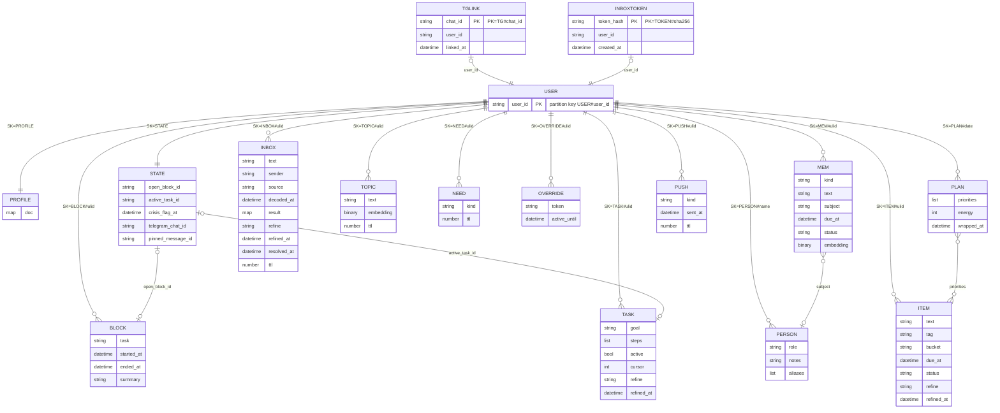

### SQLite (local)

Same logical items in one table `items(pk, sk, type, doc JSON, embedding BLOB, ttl)`, so the store
interface and tests are identical across backends.

## 9. Architecture

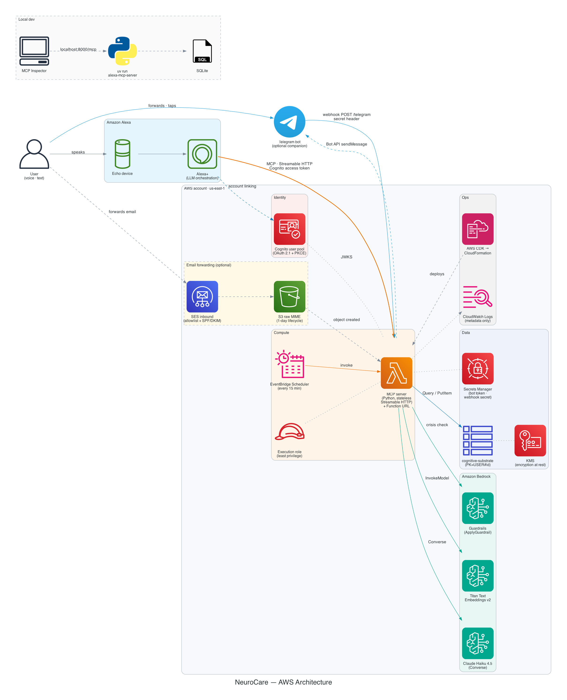

Same flow as Mermaid (renders even without the image), with the server's internal layers:

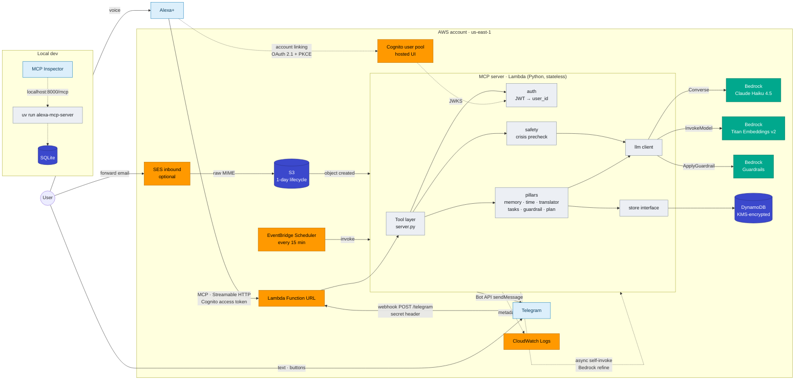

Planned module layout (not yet created):

```
src/alexa_mcp_server/
  server.py          MCPServer instance, instructions, tool registration, main()
  config.py          env settings
  auth.py            Cognito JWT (JWKS cached; iss, client_id, exp, scope) → user_id; static token
                     only with ALLOW_STATIC_TOKEN; PRM route /.well-known/oauth-protected-resource
  store/             base.py (interface), sqlite.py, dynamo.py
  llm/               bedrock.py, fake.py (tests)
  pillars/           memory.py, time.py, translator.py, tasks.py, guardrail.py, plan.py
  channels/http.py   POST /inbox route
  channels/telegram.py  webhook, link flow, triage card, buttons, pinned Today message
  channels/schedule.py  scheduled bot messages (cap, quiet hours)
  channels/email.py  SES inbound: parse forwarded email → INBOX# (optional)
  safety/crisis.py   phrase list + ApplyGuardrail
  refine.py          async self-invoke + Bedrock refine jobs (decode, decompose, split_step, brain_dump)
  lambda_handler.py  ASGI → Lambda adapter; routes async refine and scheduler events
profile_seed.yaml
infra/               CDK app: table, Lambda, Function URL, IAM (Bedrock InvokeModel, ApplyGuardrail,
                     lambda:InvokeFunction on itself), Guardrail, Cognito user pool + app client + hosted domain,
                     EventBridge Scheduler rule, Secrets Manager secrets (Telegram bot token, webhook secret),
                     optional SES receipt rule + S3 bucket for email forwarding
```

Pillar modules are plain functions taking `(store, llm, user_id, ...)` so they are testable
without MCP; `server.py` is a thin tool layer over them.

**Regenerating the AWS diagram** (dev-only, needs Graphviz):

```bash
brew install graphviz
uv run --no-project --with diagrams python docs/diagrams/aws_architecture.py
```

Environment variables: `STORE`, `TABLE_NAME`, `SQLITE_PATH`, `AUTH_TOKEN`, `ALLOW_STATIC_TOKEN`, `DEMO_USER_ID`,
`COGNITO_USER_POOL_ID`, `COGNITO_CLIENT_ID`, `COGNITO_DOMAIN`, `PUBLIC_BASE_URL`,
`BEDROCK_MODEL_ID`, `BEDROCK_EMBED_MODEL_ID`, `BEDROCK_GUARDRAIL_ID`, `BEDROCK_GUARDRAIL_VERSION`,
`TELEGRAM_BOT_TOKEN`, `TELEGRAM_WEBHOOK_SECRET` (both from SSM / Secrets Manager on AWS),
`INBOUND_EMAIL_DOMAIN`, `INBOUND_EMAIL_BUCKET` (optional),
`AWS_REGION`, `HOST`, `PORT`.

## 10. Server instructions (draft)

```
You are connected to a personal cognitive support server for this user.

- When the user returns after a break or asks what they were doing, call what_was_i_doing.
- When the user raises a worry or comes back to a subject that is bothering them, call log_topic
  with a short description of the worry, before answering.
- When the user starts or finishes a piece of work, call start_block or end_block.
- When a tool result includes suggest_reminder_minutes, offer to set an Alexa reminder for that time.
- When the user asks what a message means, call decode. If they refer to a message they just
  sent or forwarded, call decode with no message.
- When decode returns needs_work or reply_needed, make at most one offer: a reminder or a breakdown.
- After a decode, when the user asks what to say or what the sender wants, call decode_result.
- When the user sounds overwhelmed by a goal ("I don't know where to start", "this is too much"),
  call decompose with the goal. Do not ask clarifying questions first.
- When the user says "done", "next", "too big", or "not now" during a task, call done_step,
  next_step, split_step, or skip_step.
- Speak the `speak` field from tool results in plain, literal words. Do not add idioms.
- Prefer accuracy over agreement. If the user's claim conflicts with what memory shows, say so gently.
- If a tool result has crisis: true, say only the provided message and resources. Do not redirect,
  coach, or change the subject.
- When the user lists things to remember or says "brain dump", call brain_dump. Do not ask questions.
- When the user asks to plan their day, call plan_today; pass energy if they mention it.
  If they swap a priority, call plan_today again rather than editing items one by one.
- When the user says "wrap up" or "done for today", call wrap_up.
- When the user asks "what needs me?" or "anything urgent?", call triage_inbox.
- When the user asks to link Telegram, call telegram_link_code and read the code slowly.
- The user is in charge. If they say "I know, keep going", call override with keep_going_once.
```

## 11. Build phases and acceptance criteria

Each phase is demoable on its own.

| # | Phase | Done when |
|---|---|---|
| 1 | Store interface + SQLite, auth (static dev token), memory tools, profile + seed | All memory tools pass tests; `what_was_i_doing` returns seeded context in Inspector |
| 2 | Sense of time | `check_in` level boundaries tested at 59/60/89/90/119/120 min and after end-of-day; `now_context` leave-by correct |
| 3 | Translator + Bedrock wrapper | Baseline-only path tested with fake LLM failure; schema-validated LLM path tested with fake LLM; one live Bedrock smoke test; fast-first: `decode` returns the baseline without waiting on the LLM (fake LLM with a 3 s delay still returns in < 300 ms), the async refine stores `refine: done` / `failed`; embedding tier enabled (recall and rumination tested with `FakeEmbedder`, null embeddings backfilled); `POST /inbox` → `decode()` with no message decodes newest item, `NOT_FOUND` when empty; triage fields present (`related` resolved from seeded commitments, `cues` from baseline); a message containing injected instructions yields a normal result with no side effects; sender resolution tiers 1–4 tested (header line, unambiguous signature, ambiguous signature → none); `triage_inbox` orders by priority → reply_by → age and decodes at most 3 per call |
| 4 | Guardrail: crisis → rumination → hyperfocus | Crisis precheck short-circuits `remember`, `decode`, `log_topic`, and `decompose` (tested); `ApplyGuardrail` timeout → async re-run, and an async hit makes the next call return crisis first; 3rd similar `log_topic` inside window detects; override suppresses; crisis ignores override |
| 5 | Task breakdown + daily plan | Steps validated (count, minutes, verb-first, step 1 ≤ 5 min); `next_step`/`done_step` walk the list; `split_step` replaces only the current step; `skip_step` moves it to the end; fallback on LLM failure; fast-first baselines for `decompose`, `split_step`, and `brain_dump` returned without waiting on the LLM, then replaced by the refine. `brain_dump` splits multi-item text (baseline stores one item) and is short-circuited by the crisis precheck; `plan_today` never exceeds `plan.max_priorities` and respects energy; `wrap_up` rolls unfinished items |
| 6 | DynamoDB store + CDK + Lambda + account linking | Same test suite passes against moto-backed DynamoDB; `cdk deploy` succeeds; PRM served at `/.well-known/oauth-protected-resource`; 401 carries `WWW-Authenticate` with `resource_metadata`; expired/wrong-client JWTs rejected; Alexa+ account linking completes against Cognito (PKCE S256, refresh token issued); Alexa-path tools measured < 500 ms round trip on a warm Lambda |
| 6b | Telegram companion | Link code flow (expiry, single use); webhook rejects a missing/wrong secret header; unlinked chat rejected; forwarded text → triage card with buttons; buttons call `remember` / `brain_dump` / feedback; pinned Today message edited on plan change; push cap and quiet hours honored (clock fixture); local long-polling dev mode works. Optional email forwarding: Gmail/Outlook/Apple Mail forward fixtures parse the original sender; non-allowlisted or SPF/DKIM-failing mail dropped; raw object deleted after parse; card sent to linked Telegram chat |
| 7 | Stretch | `reality_check(claim)` |

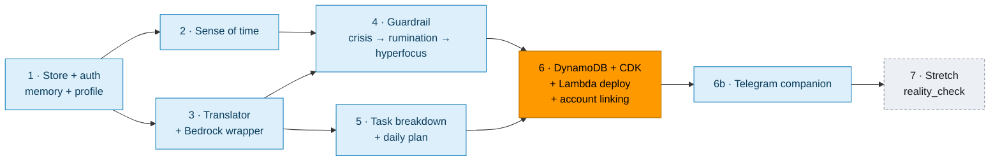

### Test approach
- `uv run pytest`; in-process MCP tests through `mcp.Client(mcp)` for tool listing, argument
  validation, `speak` presence, and crisis short-circuit.
- Pillar tests run against both store backends (parameterized fixture): SQLite and moto DynamoDB.
- `FakeLLM` returns scripted outputs or raises, for both refine and fallback paths.
- `FakeEmbedder` returns deterministic vectors so the embedding tier and rumination cosine are
  testable offline; a "no embedder" fixture covers the phase 1–2 path.
- Time is injected (clock fixture), never read from the wall clock in tests.
- Manual: MCP Inspector locally, then Alexa+ by voice, running the "One day" demo arc from the idea draft.

## 12. Open risks

| Risk | Mitigation |
|---|---|
| Alexa+ may weakly follow server instructions (e.g. not calling `log_topic` unprompted) | Strong tool descriptions; demo phrasing that triggers tools; document in friction log |
| Alexa+ may not read MCP resources | Profile also exposed as `get_profile` tool |
| Alexa+ may look for authorization-server metadata at `/.well-known/oauth-authorization-server`, while Cognito serves `openid-configuration` | Verify at phase 6; fallback: Lambda serves that path, proxying Cognito's metadata |
| 500 ms round-trip limit | Fast first, refine later (§4); Bedrock never on the Alexa request path; embedding 200 ms and ApplyGuardrail 250 ms budgets |
| Baseline answers are less insightful than refined ones | `speak` leans on sender context and phrase cues; the full refined result reaches Telegram within seconds and the next voice ask |
| Exact v2 `MCPServer` option for stateless HTTP / JSON response mode | Verify against current SDK docs at start of phase 6 |
| Lambda cold starts break the 500 ms budget | Keep dependencies small; provisioned concurrency = 1 during demo and judging windows |
| Per-user corpus outgrows in-process similarity (> ~5,000 vectors) | First drop Titan v2 to 512 or 256 dims and store vectors under their own SK prefix; only then consider a managed vector store (S3 Vectors, OpenSearch Serverless) |
| False positives in rumination/hyperfocus | Configurable thresholds, `lower_sensitivity` override, facts-not-instructions wording |
| Scope creep into a second agent or broad inbox access | Alexa+ is the only agent; connectors only forward user-chosen messages to `/inbox` |
| Notification fatigue from bot-initiated messages | Off by default, opt-in per type, daily cap, quiet hours |
| Telegram not allowed by employer or not installed | Channel is optional; Alexa alone covers every feature except unprompted messages |
| Spoofed webhook calls | Secret header check; unlinked chats rejected |
| Spoofed forwarded email | Sender allowlist plus SES SPF/DKIM verdicts; no outbound mail, so a spoof can at most add an inbox item |
| Forwarded-email formats vary by client | Fixtures for Gmail, Outlook, Apple Mail; fall back to sender resolution tiers 3–5 |
